# Blobby Volley 2 for AmigaOS 3.x / AmiCradle

Blobby Volley 2 is a head-to-head volleyball game for two players (or one
against a bot): two blobs, a net and a beach ball, first to 15 points with
the serve. GPL-2.0-or-later (`COPYING`), the code by Jonathan Sieber,
Daniel Knobe, Sven Rech and contributors, the graphics by Silvio Mummert and
the beach image by Richard Bertrand (`AUTHORS`). The graphics, sounds and bots
ship with the source. This repository holds the upstream tree as imported
(upstream [angelonuffer/blobby-volley-2](https://github.com/angelonuffer/blobby-volley-2)
at `0e998a1f0307e80a7efb088f4c2164a2cd60341c`, the SourceForge project's code
mirrored on GitHub: Blobby Volley 2 0.9c, `src/Global.h`) and the AmiCradle
port around it: 68040 + FPU, libnix, SDL 2 through GFOpenGPU, OpenAmigaGCC
16.2.0 (open3, open4 or GFOpenAmigaGCC open5). Upstream's own documents are
`README`, `AUTHORS`, `ChangeLog`, `NEWS` and `TODO`.

## Feasibility

Blobby Volley 2 0.9c draws with SDL 1.2 (a software renderer of surfaces and
blits, `RenderManagerSDL`, besides an OpenGL one and a GP2X one), plays its
three sounds through SDL's audio callback, reads its data through PhysicsFS
(from `.zip` archives or drawers), runs its bots in Lua 5.1 and reads its
settings with TinyXML (both bundled in `src/`), and plays online and on a
network through RakNet (bundled). It uses five small pieces of Boost
(`shared_ptr`, `lexical_cast`, `crc`, `circular_buffer`, `scope_exit`). The
SDK has SDL 2 (2.32.10, GFOpenGPU's `SDL2.module`) and SDL2_mixer, and no
SDL 1.2, PhysicsFS or Boost.

The choice, 3 November 2026:

- **The game's own SDL calls move to SDL 2**, as patches, as amigakobodeluxe
  did for Kobo Deluxe: `patches/0001-sdl2.patch`. The SDL renderer draws only
  with surfaces and blits, so most of it builds as it is. The display is one
  SDL 2 window and its surface (`SDL_SetVideoMode` and `SDL_Flip` become
  `SDL_CreateWindow`, `SDL_GetWindowSurface` and `SDL_UpdateWindowSurface`;
  full screen is SDL's real full screen, a screen of the game's own size,
  800x600); a small header, `src/blobby_sdl2.h` (with `blobby_sdl2.cpp`),
  gives the SDL 1.2 calls SDL 2 dropped with the meaning SDL 1.2 gave them
  (`SDL_SetAlpha`, the `SDL_SRCALPHA`/`SDL_SRCCOLORKEY` flags,
  `SDL_DisplayFormat`, `SDL_DisplayFormatAlpha`, the surface alpha SDL 1.2
  kept in `format->alpha`, `SDL_GetKeyState`, `SDL_WM_SetCaption`). The
  key names in the input settings are SDL 2's key codes (SDL 2 has no
  `SDLK_WORLD_` keys); the mouse wheel is SDL 2's wheel event; joystick
  events name the stick by its number again. Upstream coloured the blobs and
  lit the menu font by reading each 32-bit pixel as R, G, B bytes in memory,
  which holds only on a little-endian machine: those surfaces now have their
  masks set so the bytes are R, G, B on either byte order (the 68040 is
  big-endian). The OpenGL and GP2X renderers are not built, and the Graphics
  options offer SDL only. Upstream's own mixer on SDL's audio callback is
  replaced by SDL2_mixer in `patches/0008` (below); in 0001 its mute switch
  no longer unlocks SDL's audio lock without having locked it, which SDL 2's
  mutex does not allow.
- `patches/0002-no-boost.patch`: the four Boost pieces the game itself uses,
  as a few lines of standard C++ each (a CRC-32 that gives the same value as
  `boost::crc_32_type`, so replays keep their checksum; a fixed-size ring for
  the bots' delayed ball positions; `std::ostringstream` for a replay's
  name; freeing the file buffer before returning instead of `scope_exit`).
- `patches/0003-no-network.patch`: built with `BLOBBY_NO_NETWORK`, the main
  menu offers no online or network game. RakNet's sockets are not built, so
  the port needs no TCP/IP stack; only RakNet's `BitStream.cpp` is compiled,
  which the physics' (unused) network state calls name.
- `patches/0004-amiga-files.patch`: `src/dirfs/`, the PhysicsFS calls the game
  makes (search path, write directory, open, read, write, length, exists, is a
  directory, make directory, delete, list) on plain drawers through libnix,
  with PhysicsFS 2.0's names and meanings; no `.zip` archives, so the data
  ships as drawers. On AmigaOS (`__amigaos__`) the data is
  `PROGDIR:data` and the settings and replays are written in `PROGDIR:User`,
  made on the first start and searched before the data, as upstream searches
  `~/.blobby` before its installed data.
- `patches/0005-text-manager-return.patch`: upstream's
  `TextManager::createTextManager` returned nothing; GCC 16 takes a missing
  return for a path never taken, and the program would run on into the next
  code at start-up. It returns the text manager.

What could stop it, and the stop rule: every frame is drawn by the CPU into
the window surface at 800x600, and in the menus the whole background is
drawn again each frame. If play cannot hold the game's own speed (75 steps a
second, `gamefps` in the settings; every step is drawn, so a slow frame
slows the game itself), that is reported, not hidden. GFOpenMulticore has nothing to take here: one
serial game loop.

- `patches/0008-sdl2-mixer.patch`: the sounds are played by SDL2_mixer
  (GFOpenGPU's `SDL2_mixer.module`, AHI underneath) instead of upstream's
  own mixing in SDL's audio callback: the same format (44.1 kHz, 16 bits,
  stereo, 1,024-sample buffers), each sound loaded once from the data and
  played on a free channel at its volume times the global volume; mute stops
  what plays and starts nothing new. With `-fps` the log gives, every five
  seconds, the mixer's buffers, how many came more than half a buffer late,
  the longest gap between two, and the sounds started.

## Building

The port never edits the imported tree: `build-amiga.sh` copies `src/` and
`data/`, applies `patches/` with no fuzz, writes the `config.h` upstream's
CMake would write, and compiles upstream's own source lists
(`src/CMakeLists.txt`, `src/lua/CMakeLists.txt`,
`src/tinyxml/CMakeLists.txt`) less what is not built (above) and with the
port's two files, using the stove's compilers and linking the stove's
`libSDL2.a`.

Through Cradle (the build the lab tests use): `stove_build` with the stove
`os32-gcc16`, target `.` for the program and target `runtime-data` for the
game data. From a checkout, with a staged stove:

```sh
STOVE=/path/to/os32-gcc16 OUT=build-amiga sh build-amiga.sh
STOVE=/path/to/os32-gcc16 OUT=build-amiga/data sh runtime-data/build-amiga.sh
```

`build-amiga.sh` takes OpenAmigaGCC 16.2.0-open3 (archive SHA-256
`9fcc136ab59e3bb5b91d2764d0bf290b709d72d7380be4ce0cdf005edf8eff21`),
16.2.0-open4 (`495319a2ffd803278f8827cad70074029c7aa9ecbe05d037e8646ba43ab94ab2`)
or GFOpenAmigaGCC 16.2.0-open5 (Cradle's `os32-gcc16`; no archive is
published, so its receipt records the SHA-256 of the compiler's own programs)
and refuses any other. Its `receipt.json` names the compiler, the patches'
and the recipe's digests, the SDK inputs and the executable's SHA-256; the
receipts of the builds recorded here are in `receipts/`.

The game data (165 files, 2.5 MB: `data/gfx`, `data/sounds`, the six bots in
`data/scripts`, `data/backgrounds`, the settings, the three languages, the
rules and the window icon) ships as `blobby-data.tar`, a plain ustar archive
whose names all start with `data/`, with `untar`, a small Amiga unpacker
(`runtime-data/untar.c`, from amigapowermanga as amigakobodeluxe has it; OS
3.2 has no archiver). `SHA256SUMS` lists every data file. Left out:
`data/gf2x` (older graphics the game does not load), `data/scripts/old`
(older bots upstream does not install) and `data/server.xml` and
`data/onlineserver.xml` (network play is not built).

## Running

`blobby` opens an 800x600 screen of its own, the game's own frame, unscaled
(SDL's real full screen; upstream's default is an 800x600 window, and the
port changes only the default in `data/config.xml`). Options, Graphic
Options, Window Mode, OK switches to a window on the Workbench at once and
keeps it (`PROGDIR:User/config.xml`); Fullscreen Mode switches back. It
needs GFOpenGPU's `SDL2.module` and `SDL2_mixer.module` in
`LIBS:GFOpenGPU/` (older systems have them in `LIBS:OpenGPU/`), and a 68040
or 68060 with its FPU.

`-fps` logs the screen the game got and each second's frame rate to
standard output (`fps 75.0 at 12.012 s`); upstream shows the rate only in
the window's title. The game draws every step of its logic, at most 75 a
second (`gamefps` in the settings); upstream's frame dropping is never
switched on, so when the machine cannot draw 75 frames a second the game
itself runs slower, and the logged rate is the game's speed as well.

Controls are upstream's: the left player A and D to move and W to jump,
the right player the cursor keys and Up to jump; the mouse or the cursor
keys and Return in the menus; Escape pauses a game (Yes, No, Save Replay).
Options, Input Options sets a keyboard, the mouse or a joystick for each
player. On AmigaOS the joystick settings start from an Amiga stick: the
left player's from the stick or pad in port 2 (left and right, fire to
jump), the right player's from a stick in port 1 (SDL lists it when
lowlevel.library sees one there). A CD32 pad's Play, or a GFOpenInput pad's
Start, is Escape. The log names each stick SDL finds, and `SetEnv
BLOBBY_INPUT RAM:input.txt` logs every key, mouse button, joystick and pad
event the game takes, with its time. `blobby NAME BOT.lua` (or two names)
starts a game at once and quits when it ends, as upstream does; it also
saves those players in the settings.

## Rights

Code and data: GPL-2.0-or-later, upstream's `COPYING` (the source files say
"version 2 or later"; the data has no notice of its own and comes with the
code). Debian ships the same game and data in main under GPL-2+
(`debian/copyright` of the `blobby` package, `Files: *`). Lua 5.1 (MIT) and
TinyXML (zlib) are built in; RakNet (BSD-3-Clause, `src/raknet/LICENSE`) is
not, bar `BitStream.cpp`. The port's own files are GPL-2.0-or-later as the
game; the build scripts are MIT.

## Status

**In progress**, not RELEASE (see the release gates in amicradle
`docs/porting/MEASUREMENT.md`).

| Gate | State |
|---|---|
| Pinned source, reproducible build, receipts | done (open5, Cradle) |
| Launch to the menu, 800x600 on a screen of its own | done (75 frames a second; a window on the Workbench from Options) |
| Keyboard play | done (a match against a bot, two players, the menus) |
| Joystick / pad | not tested: no stick in the lab (SDL lists port 2) |
| Sound | AHI through SDL2_mixer at 44.1 kHz, no late buffers; not heard (muted lab) |
| Settings and replays across a restart | done (cold restart) |
| Drawer with GlowIcons, start from Workbench, LhA package | not yet |
| Network play | not built |

## Observed

### Build, 3 November 2026

Commit `58dec50`: clean compile and link of the imported source with
`patches/0001` to `0005`, no network code (`receipts/`). Two Cradle builds
gave the same executable and the same receipt. The compiler's warnings are
upstream's own (catching exceptions by value, an unhandled enumeration
value, a comparison of two arrays in `RenderManagerSDL::drawBlob`, one in
Lua's `ldump.c`), none in the patches.

| Compiler | Executable SHA-256 | Bytes |
|---|---|---|
| GFOpenAmigaGCC 16.2.0-open5 (Cradle `stove_build`, jobs `j20261103T025001-db880e` and `j20261103T025154-9a8613`) | `29b2137e74560761ab70fae49144d9b2cbe018261abae69277930d7167cac0c8` | 2,114,288 |

Game data (job `j20261103T025109-1f031a`): 165 files, `SHA256SUMS` digest
`517c2b35...9395` (the same from a local open3 run of the same commit's
data), archive `b6dbcf1e...15f8`, `untar` `2de6090b...b6d` (the same bytes
as amigakobodeluxe's). Lab tools (`tests/lab`, job
`j20261103T025132-d77fcb`): HoldKeys `dde62ad3...b0af`, JoyPort
`a7100d5b...7413`, Chop `d4f9b0fc...1199`.

A first start, to see that the build runs (not a gate of this step): in
`lab:blobby`, a copy of Instance-32, `blobby` from a Shell in a drawer with
the data unpacked beside it opened upstream's default 800x600 window on the
Workbench with the main menu, the title bar reading `FPS: 75` (upstream's
`gamefps`), and made `PROGDIR:User`.

### Presentation, 3 November 2026

Commit `4110cfd` adds `patches/0006-amiga-presentation.patch`: the
default in `data/config.xml` is full screen (upstream's is a window), and
on AmigaOS the game logs the screen it got and, with `-fps`, each second's
frame rate. `runtime-data/build-amiga.sh` now packs the data from a patched
copy, since the patches touch the settings' defaults. Executable (open5,
Cradle job `j20261103T032131-ea4501`): SHA-256
`22114182990d931c7ae9da7436f86d0df0e95d04220932fd85c79b012bf0d71a`
(2,115,104 bytes; `receipts/2-presentation-open5-stove_build.json`). Game
data (job `j20261103T032351-579a8d`, `receipts/2-data.json`): 165 files,
archive `11c77827...a38b`.

Run in `lab:blobby`, a copy of Instance-32 (AC090 JIT, 68040 + FPU, RTG
1920x1080, AHI, muted), with gfopenrtg's SDL2.module (`0c0bfee8...08b2`)
and SDL2_mixer.module (`07410c8b...314d`), as built from gfopenrtg
`210df77`, in both `LIBS:OpenGPU/` and `LIBS:GFOpenGPU/`; the game in
`Work:Games/BlobbyVolley2` with its data unpacked by `untar`, and no
`PROGDIR:User` before the first start.

- `blobby -fps`: the RTG head switched to 800x600 and the main menu filled
  it, frame whole (log: `window surface in video RAM (800x600, 3200 bytes a
  row)`, `screen 800x600, SDL_PIXELFORMAT_ARGB8888, 3200 bytes a row`).
  `PROGDIR:User` and `PROGDIR:User/replays` were made.
- Frames on the main menu: **75.0 a second** (74.9 to 75.1 in 49 one-second
  readings after the first, 67.3), the game's own `gamefps`.
- The blobs are blue and red in Graphic Options, as upstream's settings
  say: the colour fix for the big-endian 68040 holds.
- Options, Graphic Options, Window Mode, OK: the game moved to an 800x600
  window on the Workbench at once (`window 800x600, ...` in the log), 75
  frames a second on its main menu, 58.6 to 65.8 on the options screens.
  Exit wrote `fullscreen` `false` in `PROGDIR:User/config.xml`; the next
  start opened the window again. Fullscreen Mode, OK switched back to the
  screen of its own and saved `true`.
- Escape does nothing on the main menu (as upstream); Exit ends the game
  cleanly and the Workbench comes back.

The host was busy: in one later run the options screens fell to 14.5 to
46.8 frames a second, window and screen alike, where the same screens had
held 75 a few minutes before.

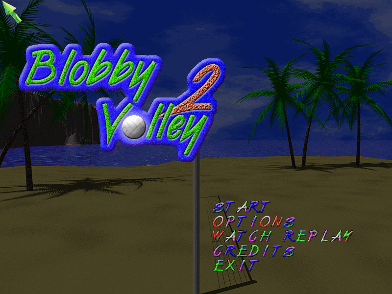
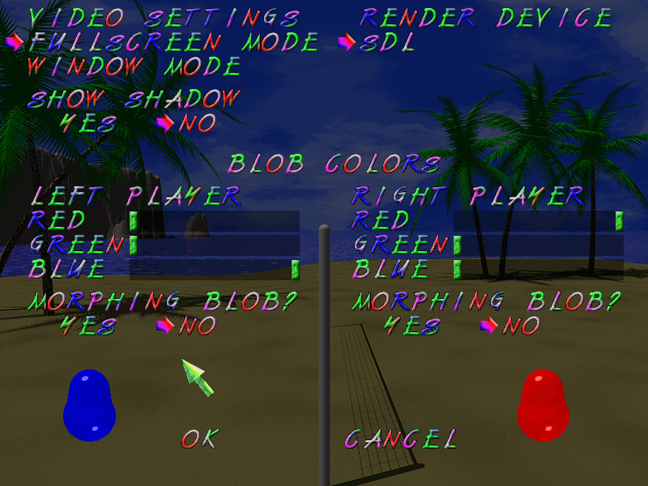
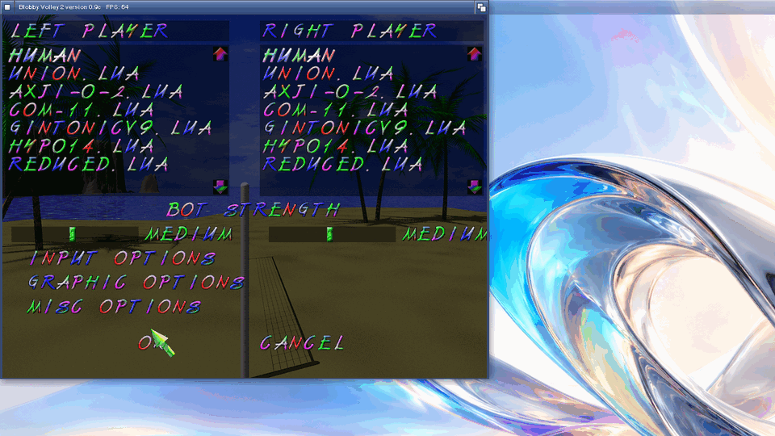

### Controls, 3 November 2026

Commit `8c1fcd8` adds `patches/0007-amiga-input.patch`: the joystick
settings in `data/inputconfig.xml` start from Amiga sticks (upstream's
jumped on the left stick pulled down and moved the right player with
buttons 0 and 1), a CD32 pad's Play or a GFOpenInput pad's Start is Escape,
the sticks SDL finds are named in the log, and `SetEnv BLOBBY_INPUT
RAM:input.txt` logs every key, mouse button, joystick and pad event with
its time. Executable (open5, Cradle job `j20261103T033354-cfff1a`): SHA-256
`e9c863ffeedd79a9c0731276e75c752175180da5127f4a4baca5f9e8c1d8ec97`
(2,116,700 bytes; `receipts/3-input-open5-stove_build.json`); data job
`j20261103T033437-3c50a9` (`receipts/3-data.json`).

In `lab:blobby` as for the presentation, the new data unpacked over the old:

- The log has `Joystick 0: "Amiga joystick port (2): joystick", 6 axes, 21
  buttons`. JoyPort, at the same time, reports lowlevel.library's port 1
  (game port 2) as `none` and port 0 as `unknown`: there is no stick in the
  lab, and SDL lists port 2 anyway, as gfopenrtg's driver always does.
- `blobby -fps Ami reduced.lua` started a match against the Reduced bot.
  `HoldKeys 60 HOLD 11 CYCLE 20,22 PERIOD 40` held W (jump) and A and D in
  turn, about 1.45 s each: the blue blob ran and jumped the whole time,
  every press and release is in the input log, and the bot won 15 to 0 in
  78 seconds (`Winner: 1`), after which the game quit, as upstream does with
  players named on the command line.
- `blobby -fps Ami Bo`, two players on one keyboard: `HoldKeys 30 HOLD
  11,4C CYCLE 20,4F,22,4E PERIOD 40` held both jump keys (W, Up) and A,
  Left, D, Right in turn; both blobs ran and jumped and the score moved
  both ways.
- Escape paused the game (Really quit? Yes, No, Save Replay); Down and
  Return chose in that box, Save Replay with OK wrote
  `PROGDIR:User/replays/1793673592.bvr` (4,688 bytes); Yes went back to the
  main menu, and Up, Return there chose Exit. Escape again while paused
  does nothing, as upstream.
- Frames in play: **75.0 a second** (73.4 to 75.2 in every one-second
  reading of both runs), the game's own speed.

The first run's HoldKeys outlived its match (it counts its time in
`Delay(1)` ticks, slower than real time here) and its last three presses
are at the start of the second run's input log, before the menu took them.

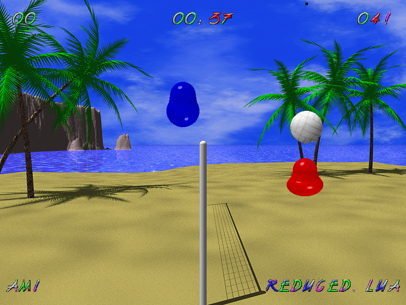
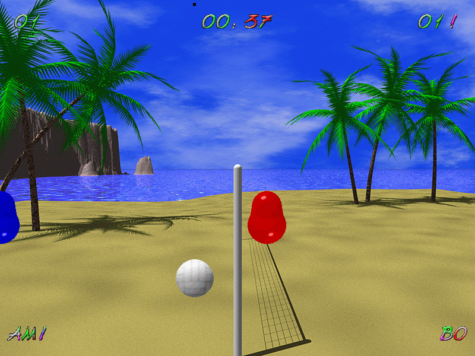
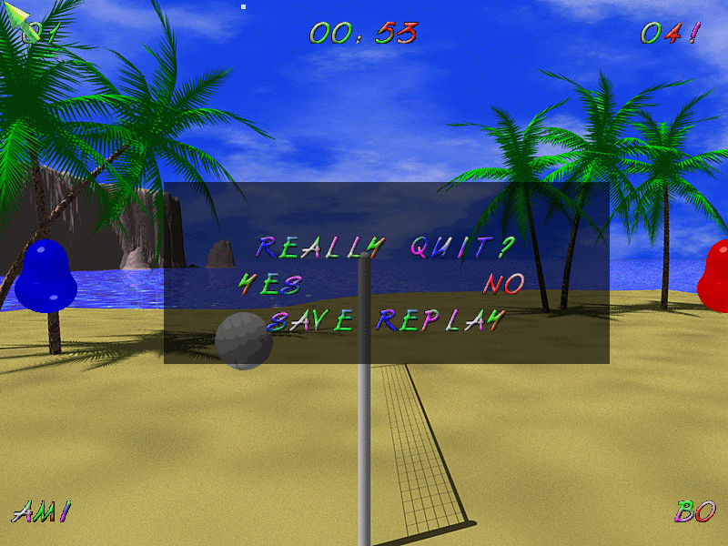

Joystick and CD32 pad: not qualified. No stick or pad event could be made
here; a person with a stick in port 2 (or a CD32 pad) has to choose
Joystick for the left player in Options, Input Options, and play.

### Sound, 3 November 2026

Commit `e4a2ad4` adds `patches/0008-sdl2-mixer.patch` and links
SDL2_mixer (`build-amiga.sh` checks the stove has `libSDL2_mixer.a` and its
header, and the receipt names both). Executable (open5, Cradle job
`j20261103T034436-8ab34b`): SHA-256
`6073e10205ba1d5fef5f5aee0564d725b5167eefbc32bd17e4603cf3d6f47aa5`
(2,129,788 bytes; `receipts/4-sound-open5-stove_build.json`). The data is
step 3's. An earlier build of the same patch without the count of sounds
started (`14b7c45`, job `j20261103T033621-d73fcd`) gave the same buffer
readings over 85 seconds.

In `lab:blobby`, with the settings as upstream has them (`global_volume`
1.0, `mute` false), `blobby -fps Ami reduced.lua` and `HoldKeys 120 HOLD 11
CYCLE 20,22 PERIOD 30`: a match against the bot, which won 15 to 0 in 93
seconds.

- `audio "ahi" through SDL2_mixer: 44100 Hz, 2 channels, 16 bits, 1024
  samples a buffer`: AHI, 23.2 ms buffers.
- **Buffers every five seconds: 215 to 217** in all 17 readings after the
  first (224, with the start-up): 43.1 a second, as 44,100 / 1,024 gives.
  **None late**; the longest gap between two buffers was 26 to 27 ms.
- **75 sounds started** (the two silent ones at start-up among them): the
  whistle at each fault and the thump of the ball on a blob, 3 to 6 every
  five seconds; none failed to load.
- Frames: 73.4 to 75.1 a second, as without sound. No freeze.

Labs are muted: AHI was opened and fed at the full rate and the sounds were
started, which is what a muted lab can show. That it sounds right is still
to be heard on a real instance.

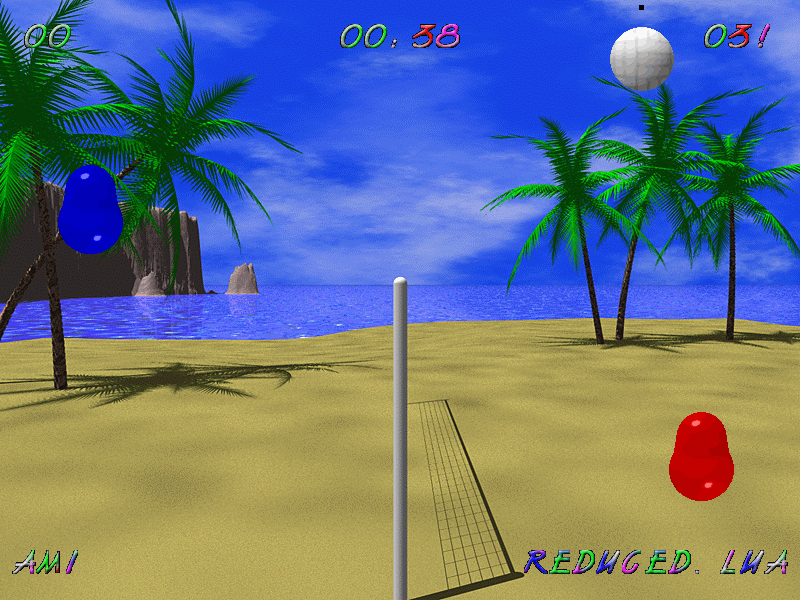

### Saves: settings and replays, 3 November 2026

Blobby Volley 2 keeps its settings (`config.xml`, and `inputconfig.xml`
once Input Options has been used) and the replays a player saves
(`replays/NAME.bvr`) in its write directory, which the port makes
`PROGDIR:User` (`patches/0004`); nothing else is written. No change was
needed for this step: the run below is step 4's build (`e4a2ad4`,
executable `6073e102...7aa5`) in `lab:blobby`.

- Options, Misc Options: the background from the beach (`strand2.bmp`) to
  the stadium (`strand1.bmp`), Show Blood on, the volume to about half;
  Graphic Options: Show Shadow Yes; OK. A game against the bot, Escape,
  Save Replay, OK, Yes, Exit.
- `PROGDIR:User` then held `config.xml` (1,380 bytes, SHA-256
  `bed838e5...4974`, with `show_shadow` `true`, `blood` `true`,
  `background` `strand1.bmp`, `global_volume` `0.515000`) and two
  replays: `1793673592.bvr` (4,688 bytes, `b2255b11...f2a9`, saved in the
  step 3 run) and `1793674230.bvr` (2,847 bytes, `9d904423...9a2d`).
- **Across a restart:** the lab was stopped and started again (Cradle's
  `lab stop` and `lab start`, a cold boot). The files were there with the
  same sizes and times, and `config.xml` and `1793674230.bvr` the same
  SHA-256. The game opened on the stadium from its first frame; Watch
  Replay listed both replays, and `1793674230` played: Ami against
  Reduced, with shadows and blood, the sounds started as in play (4 to 6
  every five seconds). Escape and Exit ended it cleanly.

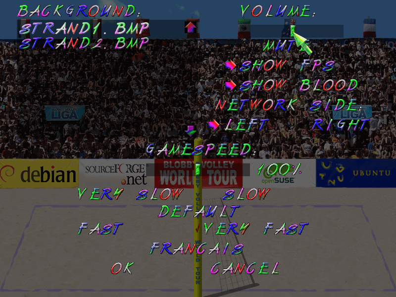
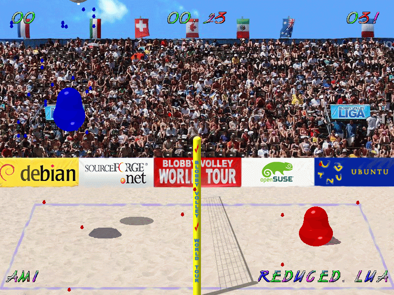
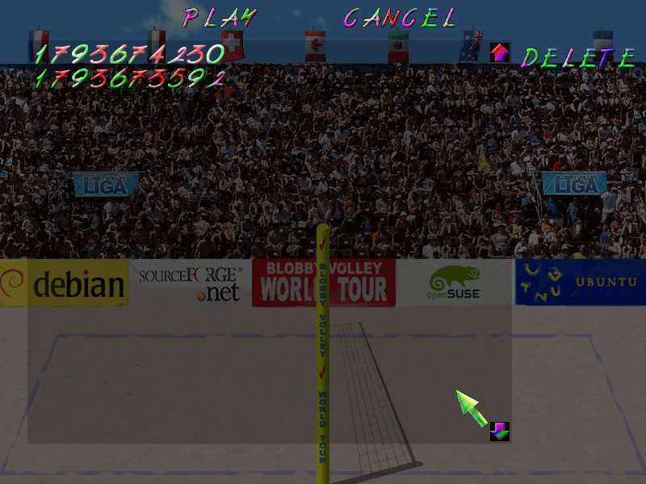
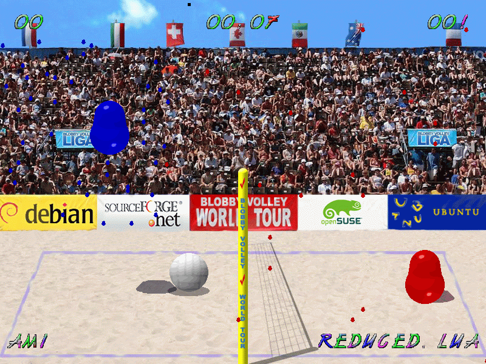

Not covered: a full disk or a write-protected drawer, and the replay name,
which upstream offers to edit and was left as the number it suggests.
